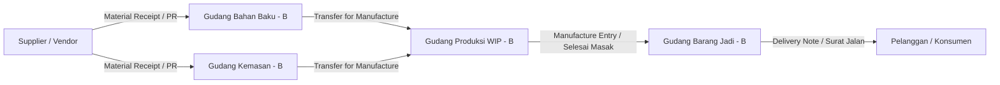

# FLOWCHART SISTEM PERSEDIAAN (INVENTORY SYSTEM)
## PT BENTO KREASI NUSANTARA (ERP_BENETO) - INDUSTRI MANUFAKTUR

Dokumen ini memuat arsitektur, diagram alir (*flowchart*), dan prosedur operasional sistem manajemen persediaan (*Inventory Management System*) pada industri manufaktur makanan kemasan bento berbasis **ERPNext**.

---

## 1. Flowchart Siklus Persediaan Manufaktur (End-to-End)

```mermaid
flowchart TD
    START([Mulai Siklus Persediaan]) --> CEK_STOK{Apakah Stok Bahan Baku & Kemasan Mencukupi?}

    %% Jalur Pengadaan (Inbound)
    CEK_STOK -- Tidak --> REQ[Material Request / PR]
    REQ --> PO[Purchase Order ke Supplier]
    PO --> PR[Penerimaan Fisik Barang: Purchase Receipt]
    PR --> IN_WH[Penyimpanan di Gudang Bahan Baku / Kemasan]
    IN_WH --> UPDATE_BIN1[(Update Bin & Stock Ledger: + Qty)]

    %% Jalur Persediaan Cukup / Produksi
    CEK_STOK -- Ya --> WO[Penerbitan Work Order Produksi]
    UPDATE_BIN1 --> WO

    %% Alur Produksi (Internal Transfer & WIP)
    WO --> TRF_WIP[Stock Entry: Material Transfer for Manufacture]
    TRF_WIP --> OUT_RM[Pengeluaran dari Gudang Bahan Baku & Kemasan: - Qty]
    OUT_RM --> IN_WIP[Penerimaan di Gudang Produksi WIP: + Qty]
    
    IN_WIP --> PROSES[Proses Pengolahan Dapur & Perakitan Bento]
    PROSES --> MFG_ENTRY[Stock Entry: Manufacture]
    
    MFG_ENTRY --> OUT_WIP[Konsumsi Bahan di Gudang WIP: - Qty]
    OUT_WIP --> IN_FG[Penerimaan Produk Jadi di Gudang Barang Jadi: + Qty]
    IN_FG --> UPDATE_BIN2[(Update Bin FG & HPP Produksi)]

    %% Alur Pengeluaran Penjualan (Outbound)
    UPDATE_BIN2 --> SO[Sales Order Pelanggan]
    SO --> DN[Penerbitan Surat Jalan: Delivery Note]
    DN --> OUT_FG[Pengeluaran Fisik dari Gudang Barang Jadi: - Qty]
    OUT_FG --> GL_COGS[Posting Otomatis Jurnal: HPP / COGS vs Persediaan]
    GL_COGS --> KONSUMEN[Barang Diterima Pelanggan]
    KONSUMEN --> END([Selesai])
```

---

## 2. Pemetaan Pergerakan Stok Antar Gudang di ERPNext

Diagram berikut menggambarkan perpindahan fisik persediaan antar 4 gudang utama:

---

## 3. Matriks Alur Dokumen Persediaan

| Tahapan | Dokumen ERPNext | Gudang Asal (*Source*) | Gudang Tujuan (*Target*) | Dampak pada Stok (*Stock Ledger*) |
|---|---|---|---|---|
| **1. Saldo Awal / Pengadaan** | *Stock Entry (Material Receipt)* atau *Purchase Receipt* | - (Vendor/Supplier) | `Gudang Bahan Baku` & `Gudang Kemasan` | **Bertambah (+)** pada bahan mentah & kemasan |
| **2. Persiapan Produksi** | *Stock Entry (Material Transfer for Manufacture)* | `Gudang Bahan Baku` & `Gudang Kemasan` | `Gudang Produksi WIP` | **Berkurang (-)** di gudang bahan, **Bertambah (+)** di lantai WIP |
| **3. Selesai Masak & Packing** | *Stock Entry (Manufacture)* | `Gudang Produksi WIP` | `Gudang Barang Jadi` | Bahan di WIP **terkonsumsi (-)**, Bento Matang **bertambah (+)** |
| **4. Pengiriman ke Pelanggan** | *Delivery Note* | `Gudang Barang Jadi` | - (Pelanggan) | Bento Matang **berkurang (-)** |
| **5. Penyesuaian / Stock Opname** | *Stock Reconciliation* | Tergantung gudang fisik | Tergantung gudang fisik | Menyesuaikan selisih fisik vs sistem |

---

## 4. Mekanisme Akuntansi Persediaan Terus-Menerus (*Perpetual Inventory*)

Sistem persediaan di ERPNext terintegrasi langsung ke buku besar akuntansi (*General Ledger*):
1. **Saat Bahan Baku Masuk**:
   * *Debit*: Akun Persediaan Barang (`1141.000`)
   * *Kredit*: Akun Penyesuaian Stok / Hutang Usaha (`5110.020` / `2110.000`)
2. **Saat Produksi Selesai (HPP Masuk ke Barang Jadi)**:
   * Biaya Bahan Baku + Biaya Operasional Tenaga Kerja Dapur (`5120.002`) dikapitalisasi menjadi nilai persediaan barang jadi (`FG-BNT-001`).
3. **Saat Barang Terkirim ke Konsumen**:
   * *Debit*: Beban Pokok Penjualan / HPP (`4210.000`)
   * *Kredit*: Persediaan Barang Jadi (`1141.000`)
